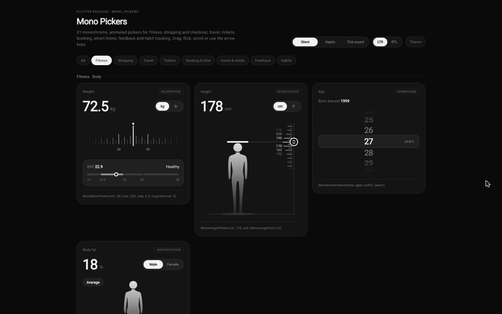
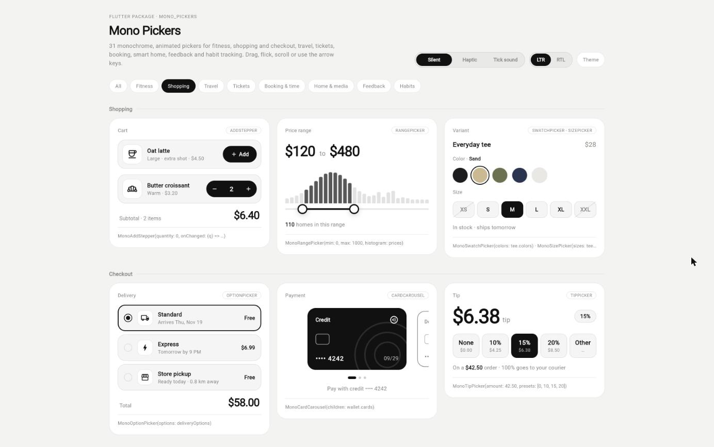
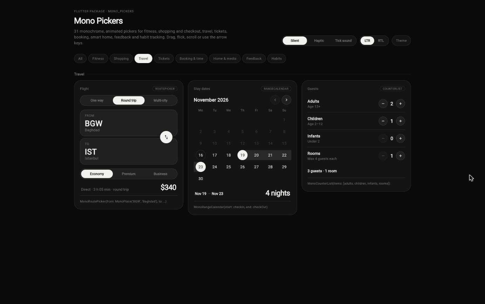

# mono_pickers



**31 animated, monochrome pickers** for Flutter: fitness, shopping and checkout, travel, tickets, booking, smart home, feedback and habit tracking.

- **One color.** Every picker draws in a single ink color at different opacities, so it looks at home in any brand. Light and dark themes are built in.
- **Physical feel.** Rulers and drums flick with momentum and snap to values. Dials and needles spring. Digits roll like an odometer. Haptic or sound ticks are optional.
- **Accessible.** Arrow, Page and Home/End keys work. Screen readers announce sliders with their values, and buttons and toggles with their state. Pickers mirror in RTL.
- **Controlled and simple.** Every picker takes a `value` and an `onChanged`. There are no runtime dependencies.

| Area | Widgets |
|---|---|
| Fitness · body | `MonoRulerPicker`, `MonoHeightPicker`, `MonoDrumPicker`, `MonoBodyFatPicker` |
| Fitness · plan | `MonoGoalPicker`, `MonoLevelPicker`, `MonoWeekPicker` |
| Workout | `MonoDialPicker`, `MonoStepper`, `MonoEffortPicker` |
| Shopping | `MonoAddStepper`, `MonoRangePicker`, `MonoSwatchPicker`, `MonoSizePicker` |
| Checkout | `MonoOptionPicker`, `MonoCardCarousel` + `MonoPaymentCard`, `MonoTipPicker` |
| Travel | `MonoRoutePicker`, `MonoRangeCalendar`, `MonoCounterList` |
| Tickets | `MonoSeatPicker`, `MonoTierPicker` |
| Booking & time | `MonoDateStrip`, `MonoSlotPicker`, `MonoTimePicker` |
| Home & media | `MonoRingDial`, `MonoFillSlider` (+ `MonoSunIcon`, `MonoVolumeIcon`) |
| Feedback | `MonoRatingPicker`, `MonoTagPicker`, `MonoMoodPicker` |
| Habits | `MonoHabitCheck`, `MonoCountPicker`, `MonoTimeOfDayPicker` |
| Building blocks | `MonoOdometer`, `MonoSegmented`, `MonoMiniStepper`, `MonoAdjustable`, `MonoPop`, `MonoSwapText` |



## Install

```yaml
dependencies:
  mono_pickers: ^0.1.1
```

## Usage

```dart
import 'package:mono_pickers/mono_pickers.dart';

// A weight ruler: drag or flick; ticks magnify around the needle.
MonoRulerPicker(
  value: kg,
  min: 30, max: 200, step: 0.5,
  majorInterval: 5, midInterval: 1,
  onChanged: (v) => setState(() => kg = v),
);

// A 3D drum.
MonoDrumPicker(
  items: [for (var a = 13; a <= 90; a++) '$a'],
  value: ageIndex,
  suffix: 'years',
  onChanged: (i) => setState(() => ageIndex = i),
);

// Rolling digits for any readout.
MonoOdometer('\$${total.toStringAsFixed(2)}', style: const TextStyle(fontSize: 26));

// Cinema seats with a selection limit.
MonoSeatPicker(
  rows: [
    for (final r in 'ABCDEFG'.split('')) MonoSeatRow(label: r, seats: 10, gapsAfter: const [2, 8]),
    const MonoSeatRow(label: 'H', seats: 8, wide: true),
  ],
  taken: hall.taken,
  selected: seats,
  maxSelection: 6,
  onChanged: (s) => setState(() => seats = s),
);

// Dates for a stay.
MonoRangeCalendar(
  start: checkIn,
  end: checkOut,
  onChanged: (s, e) => setState(() { checkIn = s; checkOut = e; }),
);
```

The [example app](example/lib/main.dart) is a full gallery with every picker in a realistic card. It also has feedback, LTR/RTL and theme switches.

## Theming and feedback

```dart
MonoPickerTheme(
  data: const MonoPickerThemeData.dark(feedback: MonoFeedback.haptic)
      .copyWith(ink: const Color(0xFFE8E3D9)),
  child: child,
);
```

Without a `MonoPickerTheme`, the pickers follow the ambient `Theme` brightness. `MonoFeedback.none`, `.haptic` and `.sound` control the tick on each value change, with a stronger tick on major values.



## Accessibility

- Slider-like pickers (ruler, drum, dial, ring, effort, level, rating, mood, fill, range thumbs) can take keyboard focus. Clicking one also gives it focus. The arrow keys step the value (mirrored in RTL), Page Up/Down make larger steps, and Home/End jump to the limits. The focus ring appears only for keyboard focus.
- Screen readers announce each picker with its label, current value and increase/decrease actions. Toggles, seats, days and chips report their selected or toggled state.

## License

MIT
